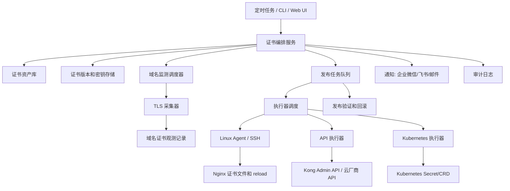

# 证书生命周期自动化方案讨论稿

## 1. 背景

公网 TLS 证书有效期正在持续缩短，未来会进入更高频的轮换周期。现阶段如果仍依赖人工在各云厂商、Kubernetes、Nginx、Konga 等系统中逐个替换证书，风险会明显增加：

- 证书绑定点分散，容易漏改。
- 云厂商证书 ID、Kubernetes Secret、公私钥文件、Ingress 配置之间没有统一关系。
- 手工操作不可审计，失败后难以回滚。
- 证书有效期缩短后，人工维护频率会过高。
- 多云环境下，不同厂商 API、证书上传方式、绑定方式不一致。

因此建议建设一套“证书生命周期管理系统”，但不要一开始做成重平台。第一阶段应优先完成资产盘点、自动续签、自动发布和可回滚能力，再逐步补充 Web UI、审批和自助能力。

## 2. 当前涉及范围

目前已知需要纳入证书管理的系统包括：

| 类型 | 当前情况 | 自动化方向 |
| --- | --- | --- |
| 阿里云 | 单个证书可能绑定 DNS、OSS、DCDN，并且 Kubernetes 中 `AlbConfig` 需要修改证书 ID | 通过阿里云 API 上传证书，拿到新证书 ID 后更新 OSS/DCDN/ALB 相关配置，并同步修改 k8s CRD |
| 腾讯云 | 上传证书后，需要手动修改 k8s Secret 中的证书 ID | 通过腾讯云 API 上传证书，记录新证书 ID，并自动 patch k8s Secret |
| 金山云 OSS | 需要手动替换绑定证书 | 通过金山云 API 或内部工具更新 OSS 证书绑定 |
| 金山云 Kubernetes | 使用 nginx-ingress，每个 namespace 里的 TLS Secret 都需要更新 cert/key | 建议由中心 Secret 自动同步到各 namespace，避免逐个手工替换 |
| AWS | 多数场景可使用 AWS 托管证书 | 优先继续使用 ACM，不强行分发私钥 |
| Cloudflare | 可使用 Cloudflare 托管证书 | 优先继续使用 Cloudflare 托管能力 |
| Yandex Cloud | 需要确认当前证书使用和绑定方式 | 做 adapter 或纳入人工审批发布流程 |
| Nginx | 可能存在文件型证书，需要替换并 reload | 自动写入证书文件，执行 `nginx -t`，通过后 reload，失败回滚 |
| Konga/Kong | 目前可能手动更新 | 优先通过 Kong Admin API 更新 certificate/sni，Konga 只作为管理界面 |

## 3. 建设目标

### 3.1 核心目标

- 建立统一证书资产台账。
- 支持声明式维护证书绑定关系，后续再逐步补充自动发现能力。
- 自动签发或导入新证书。
- 自动发布到各云厂商和运行环境。
- 每次发布有状态、有审计、有失败原因。
- 支持失败回滚。
- 支持到期预警和发布结果通知。

### 3.2 非目标

第一阶段不建议做以下事情：

- 不做完整 CMDB 替代品。
- 不做复杂审批流。
- 不做多租户平台。
- 不要求所有云厂商一次性完全自动化。
- 不把 AWS、Cloudflare 这类托管证书强行改造成自管证书。
- 不要求第一阶段自动推断所有域名和绑定资源的关系。

## 4. 总体思路

建议采用“证书资产 + 域名监测 + 执行器 + 脚本发布”的方式先落地 Web 化能力，而不是一开始只做 CLI 工具。

系统核心不是某一个脚本，而是把证书生命周期抽象为：

```text
新增或导入证书公私钥 -> 维护域名列表 -> 定时采集域名证书状态 -> 判断是否过期或临期 -> 生成发布任务 -> 通过执行器运行脚本或 adapter -> 验证生效 -> 状态记录 -> 通知/回滚
```

其中最重要的抽象是 `Certificate`、`DomainAsset`、`Executor`、`CertificatePublishTarget` 和 `CertificatePublishJob`。

第一版应优先支持人工导入证书、公私钥安全保存、域名到期监测、脚本发布和执行记录。ACME 自动续签、云厂商全量扫描和复杂审批可以放到后续阶段。

### 4.1 Certificate

`Certificate` 表示一张证书的逻辑资产，不直接等同于某一次 PEM 内容。上传证书时需要录入证书名称、公钥证书和私钥，平台解析证书得到 SAN、颁发者、序列号、生效时间和过期时间，并生成一个证书版本。证书本身不绑定环境和负责人，环境和负责人归属于域名资产、执行器和发布目标。

```yaml
certificate:
  id: cert-prod-example-com
  name: prod-example-com
  domains:
    - example.com
    - "*.example.com"
  source: manual
  issuer: DigiCert
  current_version: 20260816-001
  expires_at: "2026-10-01T00:00:00Z"
```

证书私钥不要明文保存在普通业务表中。第一版如果没有 Vault/KMS，至少要字段加密，且接口响应永远不返回私钥明文。

### 4.2 DomainAsset

`DomainAsset` 表示需要持续监测的域名。域名列表可以通过手动录入、批量导入或后续扫描生成。每个域名都需要定时发起 TLS 探测，记录线上实际证书的过期时间、指纹、颁发者和采集状态。

```yaml
domain_asset:
  id: domain-example-com
  domain: example.com
  port: 443
  environment: prod
  owner: platform
  certificate_id: cert-prod-example-com
  monitor_enabled: true
  check_interval: 6h
  last_seen_fingerprint: SHA256:xxxx
  observed_expires_at: "2026-09-25T00:00:00Z"
  alert_before_days: [30, 15, 7, 3, 1]
```

定时采集不应只读取平台保存的证书过期时间，还要以线上域名实际握手返回的证书为准。这样能发现“平台证书已更新，但线上 Nginx/Kong/CDN 仍未生效”的情况。

### 4.3 Executor

`Executor` 表示可以执行发布动作的目标环境。当前系统已有隧道节点概念，后续可以扩展为执行器：

- `ssh`：通过 SSH 在 Linux 主机执行脚本，适合少量机器或过渡期。
- `agent`：在 Linux 机器安装 agent，由平台下发任务，适合 Nginx 节点较多、网络不允许平台直连 SSH、需要更强审计的场景。
- `api`：不登录机器，直接调用 HTTP API，例如 Kong Admin API、Konga 背后的 Kong API、云厂商 API。
- `k8s`：通过 Kubernetes API 更新 Secret、Ingress、AlbConfig 等资源。

```yaml
executor:
  id: nginx-prod-01
  name: nginx-prod-01
  type: agent
  host: 10.0.1.23
  status: online
  labels:
    env: prod
    role: nginx
```

Agent 第一版建议只做任务执行通道，不把证书业务逻辑写死在 agent 里。平台下发脚本、证书版本和参数，agent 负责在本机安全执行、回传 stdout/stderr、退出码、耗时和执行状态。

### 4.4 CertificatePublishTarget

```yaml
certificate_publish_target:
  id: prod-nginx-example
  certificate_id: cert-prod-example-com
  domain_asset_id: domain-example-com
  target_type: linux-nginx
  executor_id: nginx-prod-01
  script_id: script-reload-nginx-cert
  cert_path: /etc/nginx/certs/example.crt
  key_path: /etc/nginx/certs/example.key
  health_check: https://example.com
  rollback_supported: true
```

`CertificatePublishTarget` 描述“这张证书要发布到哪里”。它可以关联执行器和脚本，也可以走内置 adapter。

第一版目标类型建议：

1. `linux-nginx`：通过 agent 或 SSH 执行脚本，更新 Linux 机器上的 Nginx 证书文件并 reload。
2. `kong-api`：通过脚本调用 Kong Admin API 更新 certificate/sni。Konga 只作为管理界面，不建议依赖 Konga 页面自动化。
3. `aliyun-cdn` / `aliyun-dcdn`：沿用当前已有能力，通过 API 上传公私钥并绑定域名。
4. `k8s-secret`：更新 Kubernetes TLS Secret。
5. `custom-script`：把证书、公私钥、域名、目标参数注入脚本，由脚本自行完成发布。

### 4.5 第一版建议：平台表单 + 手动绑定关系

第一版核心流程可以收缩为：

```text
上传证书，录入公钥证书和私钥
解析证书 SAN、过期时间和指纹，生成证书版本
维护域名列表，并关联证书
定时采集域名线上证书状态
维护发布目标，选择执行器和脚本
临期或手动触发时生成发布任务
通过执行器运行脚本或调用 adapter
发布后再次采集域名证书状态
记录状态
失败通知或回滚
```

示例配置：

```yaml
certificates:
  - id: prod-main-wildcard
    name: prod-main-wildcard
    domains:
      - example.com
      - "*.example.com"
    source: manual
    cert_ref: secret-manager://prod/certs/example.com/cert
    key_ref: secret-manager://prod/certs/example.com/key

domains:
  - domain: example.com
    certificate_id: prod-main-wildcard
    port: 443
    monitor_enabled: true
    alert_before_days: [30, 15, 7, 3, 1]

executors:
  - id: nginx-prod-01
    type: agent
    host: 10.0.1.23
    labels:
      env: prod
      role: nginx

scripts:
  - id: script-reload-nginx-cert
    type: shell
    args:
      cert_path: /etc/nginx/certs/example.crt
      key_path: /etc/nginx/certs/example.key

publish_targets:
  - id: prod-nginx-example
    certificate_id: prod-main-wildcard
    domain: example.com
    target_type: linux-nginx
    executor_id: nginx-prod-01
    script_id: script-reload-nginx-cert
    health_check: https://example.com

  - id: prod-kong-example
    certificate_id: prod-main-wildcard
    domain: api.example.com
    target_type: kong-api
    executor_id: kong-admin-api
    script_id: script-update-kong-cert
    health_check: https://api.example.com
```

该模式下，系统不需要猜测域名在哪里被使用，而是只处理配置中明确声明的目标。后续如果需要自动发现，可以把扫描结果作为“候选绑定关系”展示出来，由人工确认后写入配置或资产库。

第一版建议优先支持的目标类型：

1. `linux/nginx-file`：通过 agent 或 SSH 执行脚本，替换证书文件、执行 `nginx -t` 和 reload。
2. `kong/sni`：通过脚本调用 Kong Admin API 更新 certificate 和 SNI 绑定，Konga 作为查看入口。
3. `aliyun/cdn`、`aliyun/dcdn`：保留当前 API 上传公私钥并绑定域名的能力。
4. `custom-script`：由脚本自行调用外部 API，例如 Konga/Kong、内部网关或配置平台。
5. `k8s/tls-secret`：只在确实需要时更新 TLS Secret，不默认做全 namespace 扫描和替换。

这种方式可以把平台第一版定位成“证书导入、域名到期监测、脚本化发布和执行审计工具”，而不是完整 CMDB 或自动资产发现平台。

## 5. 推荐架构



## 6. 模块拆分

### 6.1 证书管理模块

职责：

- 上传证书，录入公钥证书和私钥。
- 解析证书 PEM，提取 SAN、颁发者、序列号、生效时间、过期时间和指纹。
- 校验证书和私钥是否匹配。
- 维护证书版本，每次导入或续签生成新版本。
- 保存证书版本状态：待发布、发布中、已发布、已废弃。
- 控制私钥访问权限，接口默认只返回指纹和引用，不返回私钥明文。

上传证书不等于立即发布。证书入库后，需要由用户选择域名和发布目标，或者由临期任务自动生成待确认发布任务。

### 6.2 域名监测模块

职责：

- 维护域名列表，包括域名、端口、环境、负责人、关联证书、监测开关和告警阈值。
- 定时通过 TLS 握手采集线上证书。
- 记录线上证书指纹、SAN、颁发者、过期时间、采集错误和最近采集时间。
- 对比平台当前证书版本和线上证书指纹，识别“已导入但未发布”“发布后未生效”“线上证书未知”等状态。
- 根据 30/15/7/3/1 天阈值产生告警。

域名监测要作为第一版核心能力，因为它可以独立发现证书过期风险，即使发布自动化暂时没有完全覆盖，也能先解决可见性问题。

### 6.3 资产发现模块

职责：

- 扫描云厂商证书列表、域名绑定、CDN/DCDN/OSS 配置。
- 扫描 Kubernetes Secret、Ingress、AlbConfig 等资源。
- 扫描 Nginx 配置文件中的证书路径和域名。
- 扫描 Kong/Konga 中的 certificate 和 SNI 配置。
- 输出候选资产清单。

第一阶段不强依赖自动发现。绑定关系不要求自动推断，可以先由维护者通过平台表单手动声明。

自动发现绑定关系建议作为第二阶段之后的增强能力：

- 扫描结果先作为候选绑定关系。
- 候选关系需要人工确认。
- 确认后再进入正式 `BindingTarget`。
- 不允许扫描结果直接触发生产发布。

### 6.4 证书签发模块

职责：

- 支持 ACME DNS-01。
- 支持 wildcard 证书。
- 支持导入已有证书。
- 保存证书版本和过期时间。

建议：

- 能用 wildcard 的域名优先使用 wildcard，减少证书数量。
- DNS 托管在不同厂商时，通过 DNS adapter 完成 TXT 记录写入。
- AWS、Cloudflare 托管证书场景保持原生能力，不强行替换。

第一版可以先支持人工导入证书。ACME 自动签发作为第二阶段能力接入，但数据模型要从一开始支持 `source=manual/acme/cloud-managed`。

### 6.5 执行器模块

职责：

- 管理执行器，包括 SSH、Agent、API、Kubernetes 等类型。
- 保存执行器连接信息、标签、状态、最近心跳和可执行能力。
- 为发布任务选择执行器。
- 下发脚本和参数，回收执行结果。
- 记录 stdout、stderr、退出码、耗时、操作者和任务 ID。

Linux Nginx 场景建议优先支持 agent：

- Agent 安装在 Nginx 机器上，主动或长连接接收平台任务。
- 平台不直接保存大量服务器 SSH 密钥。
- Agent 本地执行脚本，权限可以被限制在证书目录、nginx 校验和 reload 命令范围内。
- Agent 回传执行结果，平台统一记录审计。

SSH 可以作为过渡方案，但不建议作为长期唯一方案。机器数量变多后，SSH 密钥管理、网络连通性和审计都会变复杂。

### 6.6 脚本管理与脚本发布模块

职责：

- 管理脚本模板，支持 shell、python 和后续 webhook/http 类型。
- 脚本可以关联一个或多个执行器，形成可复用的发布动作。
- 发布任务运行脚本时注入标准参数，例如证书、公钥证书路径、私钥路径、域名、版本号、目标配置。
- 脚本执行前做 dry-run 或参数校验。
- 脚本执行后由平台统一做域名 HTTPS 探测，不完全依赖脚本自报成功。

脚本不应该保存证书内容，也不应该直接访问平台数据库。平台在每次发布任务中负责把指定证书版本注入给执行器，执行器再以固定协议运行脚本。

推荐脚本执行协议：

```text
平台选择 certificate_version、publish_target、executor、script
平台解密证书版本，生成一次性任务包
执行器创建临时工作目录
写入 cert.pem、key.pem、params.json
设置环境变量 CERT_FILE、KEY_FILE、PARAMS_FILE、DOMAIN、CERT_VERSION、JOB_ID
执行脚本
采集 stdout、stderr、exit_code、duration
清理临时工作目录
平台重新探测域名线上证书
```

`params.json` 用来承载目标差异化参数，避免把大量参数塞进命令行：

```json
{
  "domain": "example.com",
  "cert_path": "/etc/nginx/certs/example.crt",
  "key_path": "/etc/nginx/certs/example.key",
  "reload_command": "systemctl reload nginx",
  "health_check": "https://example.com"
}
```

脚本模板只关心标准输入文件和参数文件。例如 Linux Nginx 脚本只读取 `CERT_FILE`、`KEY_FILE` 和 `PARAMS_FILE`，不需要知道证书存储在哪里。

Nginx 示例脚本职责：

```text
读取 CERT_FILE、KEY_FILE、PARAMS_FILE
校验证书和私钥是否匹配
备份当前证书
替换目标证书文件或软链
执行 nginx -t
通过后 reload nginx
失败则恢复旧证书
输出结构化结果
```

Nginx 脚本模板示例：

```bash
#!/bin/sh
set -eu

: "${CERT_FILE:?missing CERT_FILE}"
: "${KEY_FILE:?missing KEY_FILE}"
: "${PARAMS_FILE:?missing PARAMS_FILE}"

CERT_PATH="$(jq -r '.cert_path' "$PARAMS_FILE")"
KEY_PATH="$(jq -r '.key_path' "$PARAMS_FILE")"
RELOAD_COMMAND="$(jq -r '.reload_command // "systemctl reload nginx"' "$PARAMS_FILE")"
WORK_DIR="${WORK_DIR:-$(dirname "$CERT_FILE")}"
BACKUP_DIR="/etc/nginx/certs/backup/${JOB_ID:-manual}-$(date +%Y%m%d%H%M%S)"

openssl x509 -noout -modulus -in "$CERT_FILE" | openssl md5 > "$WORK_DIR/cert.md5"
openssl rsa -noout -modulus -in "$KEY_FILE" | openssl md5 > "$WORK_DIR/key.md5"
cmp "$WORK_DIR/cert.md5" "$WORK_DIR/key.md5"

mkdir -p "$BACKUP_DIR"
[ -f "$CERT_PATH" ] && cp "$CERT_PATH" "$BACKUP_DIR/cert.bak"
[ -f "$KEY_PATH" ] && cp "$KEY_PATH" "$BACKUP_DIR/key.bak"

install -m 0644 "$CERT_FILE" "$CERT_PATH"
install -m 0600 "$KEY_FILE" "$KEY_PATH"

if nginx -t; then
  sh -c "$RELOAD_COMMAND"
  printf '{"status":"success","message":"nginx certificate updated"}\n'
else
  [ -f "$BACKUP_DIR/cert.bak" ] && cp "$BACKUP_DIR/cert.bak" "$CERT_PATH"
  [ -f "$BACKUP_DIR/key.bak" ] && cp "$BACKUP_DIR/key.bak" "$KEY_PATH"
  nginx -t || true
  printf '{"status":"failed","message":"nginx test failed, rolled back"}\n'
  exit 1
fi
```

Kong/Konga 示例脚本职责：

```text
读取 CERT_FILE、KEY_FILE、PARAMS_FILE
从参数中读取 SNI、Kong Admin API 地址和凭证引用
调用 Kong Admin API 创建或更新 certificate
维护 SNI 与 certificate 的绑定
查询 API 确认配置已更新
输出 certificate id 和变更结果
```

Konga 本身建议只作为界面，不作为自动化入口。如果用户口径上说“更新 Konga 证书”，实现上应优先调用 Konga 背后的 Kong Admin API。

Kong 脚本模板示例：

```bash
#!/bin/sh
set -eu

: "${CERT_FILE:?missing CERT_FILE}"
: "${KEY_FILE:?missing KEY_FILE}"
: "${PARAMS_FILE:?missing PARAMS_FILE}"

KONG_ADMIN_URL="$(jq -r '.kong_admin_url' "$PARAMS_FILE")"
SNI="$(jq -r '.sni // .domain' "$PARAMS_FILE")"
TOKEN="$(jq -r '.token // empty' "$PARAMS_FILE")"

if [ -n "$TOKEN" ]; then
  RESPONSE="$(curl -sS -X POST "$KONG_ADMIN_URL/certificates" \
    -H "Authorization: Bearer $TOKEN" \
    -F "cert=@$CERT_FILE" \
    -F "key=@$KEY_FILE" \
    -F "snis[]=$SNI")"
else
  RESPONSE="$(curl -sS -X POST "$KONG_ADMIN_URL/certificates" \
    -F "cert=@$CERT_FILE" \
    -F "key=@$KEY_FILE" \
    -F "snis[]=$SNI")"
fi

printf '%s\n' "$RESPONSE"
```

脚本模板可以要求执行器预装基础命令，例如 `openssl`、`jq`、`curl`。执行器需要在注册或心跳时上报能力，平台在发布前检查脚本依赖是否满足。

### 6.7 发布编排模块

职责：

- 根据证书和已声明的绑定关系生成发布计划。
- 按目标逐个发布。
- 记录每个目标发布状态。
- 支持失败重试。
- 支持失败后回滚。
- 发布后执行 HTTPS 探测或配置校验。

第一版应支持平台后台任务，也可以保留 CLI 能力：

```text
导入证书版本
选择域名和发布目标
生成发布计划
执行 dry-run
确认发布
按目标调用执行器或 adapter
发布后采集域名线上证书
```

其中 `--dry-run` 只生成发布计划和风险提示，不修改任何资源；`--apply` 才真正调用 adapter 执行更新。

发布状态建议：

```text
pending -> running -> success
pending -> running -> failed
success -> rollback_running -> rollback_success
success -> rollback_running -> rollback_failed
```

### 6.8 云厂商 Adapter

每个云厂商做成独立 adapter，避免把不同厂商逻辑写死在主流程里。

建议接口：

```text
ScanBindings()
UploadCertificate()
UpdateBinding()
VerifyBinding()
RollbackBinding()
```

优先级建议：

1. Kubernetes Secret / AlbConfig
2. 阿里云 OSS / DCDN / ALB
3. 腾讯云证书上传和 k8s Secret ID 更新
4. 金山云 OSS
5. Nginx
6. Kong/Konga
7. Yandex Cloud

### 6.9 Kubernetes 模块

重点处理两类问题：

1. 更新 TLS Secret 中的 `tls.crt` 和 `tls.key`。
2. 更新 CRD 或 Secret 中引用的云证书 ID。

对于 nginx-ingress 多 namespace 证书同步，建议不要由主系统逐个维护业务 namespace，而是引入同步机制：

- 方案 A：使用 cert-manager + reflector 类工具同步 Secret。
- 方案 B：使用 external-secrets 从统一密钥源同步。
- 方案 C：自研一个很小的 Secret Sync Controller。

优先推荐 A 或 B，除非现有环境限制较多。

### 6.10 Nginx 模块

发布流程建议：

```text
写入新证书到临时路径
校验证书和私钥是否匹配
替换软链或目标文件
执行 nginx -t
通过后 reload
失败则恢复旧证书
执行 HTTPS 探测
```

不要直接覆盖原文件后立刻 reload。需要保留上一个可用版本。

Nginx 模块可以先不做成内置 adapter，而是通过“执行器 + 脚本”落地。等脚本模式稳定后，再把公共流程沉淀成内置 Nginx adapter。

### 6.11 Kong/Konga 模块

如果底层是 Kong Gateway，应优先使用 Kong Admin API：

- 上传或更新 certificate。
- 维护 SNI 与 certificate 的绑定关系。
- 发布后通过域名探测验证证书是否生效。

Konga 建议只作为人工查看入口，不作为自动化依赖。

## 7. 数据模型建议

### 7.1 证书表

| 字段 | 说明 |
| --- | --- |
| id | 证书内部 ID |
| domains | 域名和 SAN |
| issuer | 签发机构 |
| source | acme、manual、cloud-managed |
| expires_at | 过期时间 |
| status | active、expiring、expired、revoked |
| current_version_id | 当前版本 |

### 7.2 证书版本表

| 字段 | 说明 |
| --- | --- |
| version_id | 证书版本 |
| certificate_id | 所属证书 |
| cert_ref | 证书内容引用 |
| key_ref | 私钥内容引用 |
| fingerprint_sha256 | 证书指纹 |
| serial_number | 证书序列号 |
| not_before | 生效时间 |
| not_after | 过期时间 |
| status | pending、active、deprecated、revoked |
| created_at | 创建时间 |
| activated_at | 生效时间 |
| previous_version_id | 上一个版本 |

### 7.3 域名资产表

| 字段 | 说明 |
| --- | --- |
| id | 域名资产 ID |
| domain | 域名 |
| port | TLS 端口，默认 443 |
| certificate_id | 期望使用的证书 |
| environment | prod、staging、test |
| owner | 负责人或团队 |
| monitor_enabled | 是否启用定时采集 |
| check_interval | 采集周期 |
| alert_before_days | 告警阈值 |
| last_observed_version_id | 最近匹配到的平台证书版本 |
| last_seen_fingerprint | 线上证书指纹 |
| observed_expires_at | 线上证书过期时间 |
| last_check_status | success、failed |
| last_check_error | 最近采集错误 |
| last_checked_at | 最近采集时间 |

### 7.4 执行器表

| 字段 | 说明 |
| --- | --- |
| id | 执行器 ID |
| name | 执行器名称 |
| type | ssh、agent、api、k8s |
| host | 主机或 API 地址 |
| status | online、offline、disabled |
| labels | 环境、角色、地域等标签 |
| auth_ref | 凭证引用 |
| last_heartbeat_at | agent 最近心跳时间 |
| description | 描述 |

### 7.5 脚本表

| 字段 | 说明 |
| --- | --- |
| id | 脚本 ID |
| name | 脚本名称 |
| type | shell、python、http |
| content | 脚本内容或 HTTP 模板 |
| input_schema | 参数结构，例如 cert_path、key_path、kong_api_url |
| injection_mode | file、env、mixed，默认 file |
| entrypoint | 执行入口，例如 `sh script.sh` 或 `python3 script.py` |
| timeout_seconds | 超时时间 |
| status | enabled、disabled |
| description | 描述 |

### 7.6 绑定目标表

| 字段 | 说明 |
| --- | --- |
| id | 绑定目标 ID |
| certificate_id | 关联证书 |
| domain_asset_id | 关联域名 |
| target_type | aliyun-dcdn、linux-nginx、kong-api、k8s-secret、custom-script |
| executor_id | 执行器 ID |
| script_id | 脚本 ID，可为空，内置 adapter 不需要 |
| target_ref | 云资源 ID、namespace/name、文件路径等 |
| parameters | 目标参数 JSON，例如证书路径、Kong SNI、API 路径 |
| last_deployed_version | 最近发布的证书版本 |
| last_status | 最近发布状态 |
| rollback_ref | 回滚需要的旧配置 |

### 7.7 发布任务表

| 字段 | 说明 |
| --- | --- |
| job_id | 发布任务 ID |
| certificate_id | 证书 ID |
| version_id | 发布版本 |
| target_id | 发布目标 |
| executor_id | 本次执行器 ID |
| script_id | 本次脚本 ID |
| workdir_policy | 临时工作目录策略 |
| status | pending、running、success、failed |
| error_message | 失败原因 |
| started_at | 开始时间 |
| finished_at | 结束时间 |

### 7.8 脚本执行记录表

| 字段 | 说明 |
| --- | --- |
| execution_id | 执行记录 ID |
| job_id | 关联发布任务 |
| executor_id | 执行器 ID |
| script_id | 脚本 ID |
| status | pending、running、success、failed、timeout |
| exit_code | 退出码 |
| stdout | 标准输出 |
| stderr | 标准错误 |
| injected_files | 注入文件清单，例如 cert.pem、key.pem、params.json，不记录内容 |
| cleanup_status | 临时文件清理状态 |
| duration_ms | 耗时 |
| started_at | 开始时间 |
| finished_at | 结束时间 |

## 8. 阶段计划

### 阶段 0：基础台账和证书导入

周期：1-2 周

目标：

- 建立证书表和证书版本表。
- 支持上传证书，录入公钥证书和私钥。
- 解析证书 SAN、颁发者、序列号、指纹、生效时间和过期时间。
- 校验证书和私钥是否匹配。
- 明确私钥加密存储和权限控制方式。
- 保留当前阿里云 CDN/DCDN 手动更新能力，作为发布目标之一。

产出：

- 证书资产管理页面。
- 证书版本记录。
- 证书导入校验。
- 私钥不明文返回的接口约束。

### 阶段 1：域名列表和到期监测

周期：2-3 周

目标：

- 支持维护域名列表，域名可关联证书。
- 支持批量导入域名。
- 定时采集域名线上 TLS 证书。
- 对比线上证书指纹和平台证书版本。
- 实现到期预警和采集失败告警。
- 不做自动修改。

产出：

- 每日证书到期报告。
- 30/15/7/3/1 天预警。
- 域名线上证书状态。
- 已导入未发布、发布未生效、线上证书未知等状态。

### 阶段 2：执行器和脚本发布

周期：3-5 周

目标：

- 建立执行器模型，先支持 SSH，随后支持 Linux Agent。
- 脚本管理支持关联执行器运行。
- 发布任务可以把证书、公钥、私钥、域名、版本号和目标参数注入脚本。
- 记录脚本执行状态、输出、退出码和耗时。
- 发布后自动触发域名采集验证。

优先解决：

- Linux Nginx 证书替换：写临时文件、校验、备份、替换、`nginx -t`、reload、失败回滚。
- Kong/Konga 证书更新：脚本调用 Kong Admin API 更新 certificate/sni。
- 自定义脚本发布：适配内部网关、配置平台或其他 API。

产出：

- 执行器管理。
- 脚本与执行器关联。
- Nginx 证书发布脚本模板。
- Kong Admin API 发布脚本模板。
- 发布状态记录。
- 失败通知。

### 阶段 3：发布编排和回滚

周期：3-5 周

目标：

- 建立发布目标表。
- 支持一个证书版本发布到多个目标。
- 支持 dry-run、手动确认、分批发布。
- 支持失败重试和回滚。
- 发布后统一做 HTTPS 探测。

产出：

- 发布前 dry-run。
- 发布任务编排。
- 发布后探测。
- 失败回滚。

### 阶段 4：云厂商和 Kubernetes Adapter

周期：4-8 周

目标：

- 阿里云 OSS/DCDN/ALB 自动替换，复用当前 CDN/DCDN API 能力。
- 腾讯云证书上传和绑定更新。
- 金山云 OSS 自动替换。
- 按需支持 Kubernetes TLS Secret、Ingress、AlbConfig。
- Yandex Cloud 按实际能力接入。

产出：

- 云厂商 adapter。
- Kubernetes adapter。
- 统一发布目标和状态记录。

### 阶段 5：自动续签、自动发现和流程化

周期：3-6 周

目标：

- 支持 ACME DNS-01 自动签发。
- 支持 wildcard 证书。
- 支持自动发现候选绑定关系。
- 展示发布任务和失败原因。
- 支持手动触发续签、发布和回滚。
- 支持简单审批和审计。

第一版 UI 不需要复杂，重点是证书、域名、执行器、脚本、发布任务这几类核心对象的可见性和可操作性。

## 9. 技术选型建议

### 9.1 后端语言

建议优先 Go 或 Python。

Go 适合：

- 长期运维工具。
- 云厂商 SDK 集成。
- Kubernetes client-go。
- 打包成单二进制。

Python 适合：

- 快速原型。
- 脚本生态。
- 运维团队已有 Python 经验。

如果团队已有 Go/Kubernetes 经验，建议用 Go。

### 9.2 存储

第一阶段可以用 SQLite 或 PostgreSQL。

建议：

- 原型和单机部署：SQLite。
- 多人使用、Web UI、任务并发：PostgreSQL。

证书私钥不要直接明文存在数据库里。建议使用：

- Vault。
- 云 KMS + Secret Manager。
- Kubernetes Secret 加密。
- 至少使用数据库字段加密。

### 9.3 任务调度

可选方案：

- 平台内置调度器，负责域名 TLS 采集、临期扫描和发布任务触发。
- 独立 worker + 队列，负责脚本发布、云厂商 API 调用和重试。
- Kubernetes CronJob + CLI，作为批处理或离线任务补充。
- Temporal / Argo Workflows。

第一阶段建议先用平台内置调度器，和当前 Web 后端集成成本最低。等发布任务并发、重试和回滚逻辑变复杂后，再拆独立 worker + 队列。

### 9.4 配置方式

第一版以平台表单为主，声明式配置可以作为批量导入、备份和 GitOps 管理方式。配置对象应覆盖证书、域名、执行器、脚本和发布目标：

```yaml
certificates:
  - id: prod-example-com
    name: prod-example-com
    domains:
      - example.com
      - "*.example.com"
    source: manual
    cert_ref: secret-manager://prod/certs/example.com/cert
    key_ref: secret-manager://prod/certs/example.com/key

domains:
  - domain: example.com
    certificate_id: prod-example-com
    monitor_enabled: true

publish_targets:
  - id: prod-nginx-example
    certificate_id: prod-example-com
    domain: example.com
    target_type: linux-nginx
    executor_id: nginx-prod-01
    script_id: script-reload-nginx-cert
```

好处：

- 可以 GitOps 管理。
- 变更可 review。
- 易于回滚。
- 可以和 Web UI 批量导入导出互补。

## 10. 安全要求

- 云厂商 AK/SK 使用最小权限。
- 不同环境使用不同凭证。
- 私钥加密存储。
- 操作全量审计。
- 发布前支持 dry-run。
- 高风险目标支持人工确认。
- 不在日志中打印私钥。
- 不把证书私钥写入临时不安全目录。
- 失败后通知明确到具体目标和错误原因。
- Agent 执行权限最小化，只允许访问证书目录、Nginx 校验和 reload 等必要命令。
- 脚本参数需要脱敏，执行日志默认不展示私钥、公钥全文和云厂商密钥。
- 平台下发给执行器的证书任务包必须是一次性任务包，包含 `cert.pem`、`key.pem`、`params.json` 和任务元信息。
- 执行器临时工作目录必须使用受限权限，例如目录 `0700`、私钥文件 `0600`。
- 脚本执行结束后无论成功失败都要清理临时证书文件，并记录 `cleanup_status`。
- 日志只记录证书指纹、版本号、文件名和目标路径，不记录 PEM 内容。

## 11. 告警和观测

至少需要：

- 证书剩余有效期。
- 即将过期证书数量。
- 过期证书数量。
- 发布成功率。
- 发布失败目标列表。
- 最近一次成功发布时间。
- 证书绑定目标数量。

通知渠道：

- 企业微信。
- 飞书。
- 邮件。
- Prometheus Alertmanager。

建议告警规则：

```text
证书剩余有效期 <= 30 天：普通提醒
证书剩余有效期 <= 15 天：高优先级提醒
证书剩余有效期 <= 7 天：紧急提醒
证书已过期：故障级别提醒
自动发布失败：立即提醒
域名资产无负责人：每日报告
```

## 12. 风险点

| 风险 | 说明 | 缓解方式 |
| --- | --- | --- |
| 绑定关系漏登 | 某些证书实际被业务使用但未写入声明式配置 | 变更 review + 定期扫描 + 人工认领 + HTTPS 探测结合 |
| 云厂商 API 不一致 | 各云证书上传和绑定接口差异大 | adapter 隔离差异 |
| 发布失败导致业务证书异常 | 替换证书后服务不可用 | 发布前校验、发布后探测、失败回滚 |
| 私钥泄露 | 多系统分发私钥有风险 | 加密存储、最小权限、审计 |
| 证书数量过多 | 每个域名单独证书会增加复杂度 | 优先 wildcard 和 SAN 合并 |
| 多 namespace Secret 漏更新 | nginx-ingress 依赖各 namespace Secret | 如确实存在该模式，优先使用 Secret 同步机制，不由主流程逐个维护 |
| 人工绕过平台 | 平台台账与真实环境不一致 | 定期扫描真实环境，以扫描结果为准 |

## 13. 推荐实施顺序

建议优先级如下：

1. 上传证书功能：录入公钥证书和私钥，解析证书信息，生成证书版本。
2. 域名列表：支持手动新增和批量导入域名，关联证书。
3. 定时采集：定时 TLS 探测域名线上证书，判断是否过期、临期或发布未生效。
4. 到期预警：30/15/7/3/1 天告警和采集失败告警。
5. 执行器管理：先复用 SSH 能力，随后建设 Linux Agent。
6. 脚本管理增强：脚本可以关联执行器运行，并接收证书、私钥、域名和目标参数。
7. Linux Nginx 发布：通过 agent/SSH 执行脚本替换证书、`nginx -t`、reload 和回滚。
8. Kong/Konga 发布：通过脚本调用 Kong Admin API 更新 certificate/sni。
9. 发布目标和发布任务：一个证书版本可发布到多个目标，记录状态和失败原因。
10. 阿里云 CDN/DCDN/OSS、腾讯云、金山云、Kubernetes adapter。
11. ACME DNS-01 自动续签。
12. 自动发现候选绑定关系、审批和审计增强。

## 14. 讨论问题

需要团队确认以下问题：

- 当前证书来源是什么：商业证书、Let’s Encrypt、自建 CA、云厂商托管证书？
- DNS 是否都能通过 API 自动写 TXT 记录？
- 哪些域名可以合并成 wildcard 证书？
- 哪些业务必须使用单域名证书？
- 各云账号是否能提供最小权限 AK/SK？
- Kubernetes 集群数量、版本、访问方式是什么？
- 金山云 nginx-ingress 是否允许引入 Secret 同步组件？
- Nginx 节点是否允许安装 agent，agent 需要哪些最小权限？
- 过渡期是否允许 SSH 发布，SSH 凭证如何托管和审计？
- 脚本执行时是否允许把私钥下发到目标机器，目标机器如何清理临时文件？
- Kong Admin API 是否可访问？
- Konga 当前只是管理界面，底层 Kong Admin API 地址和鉴权方式是什么？
- 是否需要人工审批生产证书发布？
- 证书失败回滚的 SLA 要求是什么？

## 15. 建议结论

建议采用分阶段建设：

第一步先做“证书新增、公私钥版本管理、域名列表和定时采集”，解决哪些域名即将过期、线上实际证书是否已经生效的问题。

第二步做“执行器和脚本发布”，让 Linux Nginx、Kong/Konga 这类差异较大的目标先通过脚本跑通，并沉淀执行记录、失败原因和回滚约束。

第三步做“发布目标和发布编排”，把一张证书发布到多个目标，发布后统一通过域名 TLS 探测验证。

第四步再逐步接入阿里云、腾讯云、金山云、Kubernetes adapter，以及 ACME 自动续签、自动发现、审批和自助能力。

最终形态应该是一个轻量证书生命周期管理平台。第一版应以 Web 表单、域名定时采集、执行器、脚本发布和可审计任务为主，避免一开始把重点放在全量自动发现或所有云厂商适配上导致迟迟不能落地。
