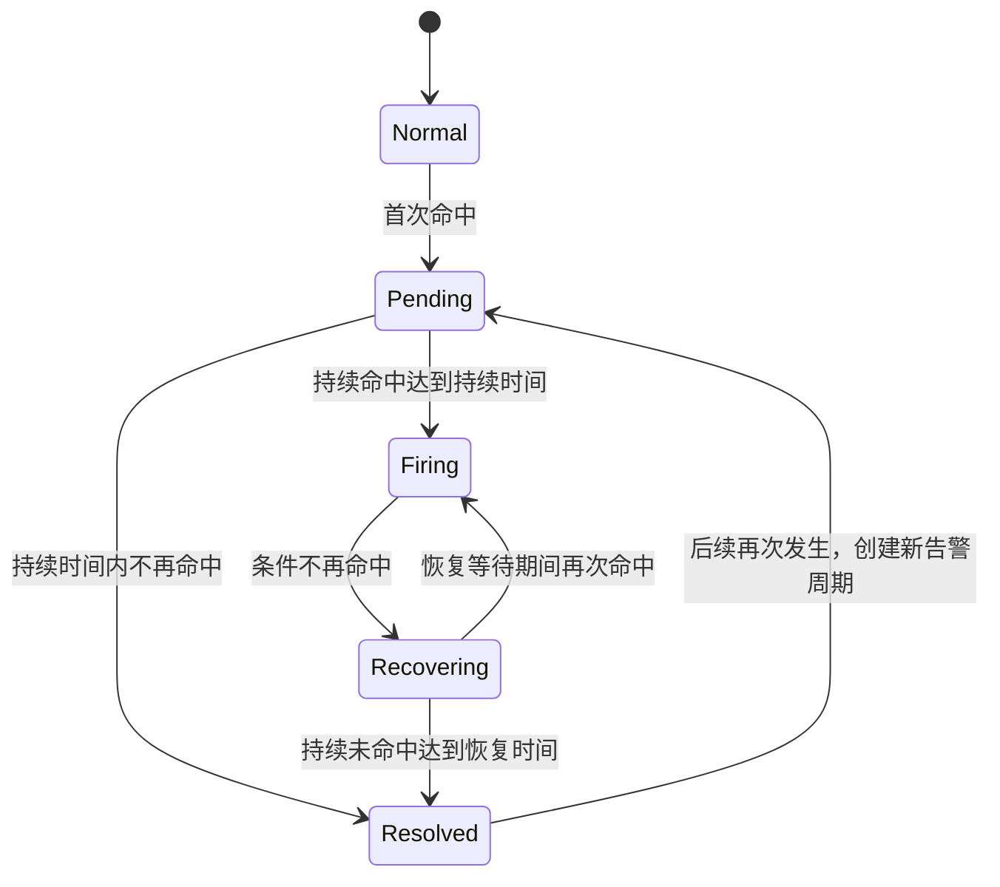

# 告警生命周期管理设计

## 文档目的

本文用于记录告警规则从启用、周期评估、首次命中、持续触发、通知、恢复到历史归档的完整业务逻辑，并列出后端仍需补齐的能力。

本文描述的是目标行为。实际开发时，应以本文作为接口、数据模型和状态机设计的基础，避免把告警系统简化成“定时执行一次 PromQL”。

## 核心业务逻辑

1. 用户创建并启用告警规则。
2. 后端调度器按照规则配置的执行频率运行 PromQL。
3. 查询结果进入告警条件判断。
4. 首次命中条件时，在所选故障中心创建一条预告警，状态为 `pending`。
5. 条件持续命中达到配置的持续时间后，预告警转为正式告警，状态为 `firing`，并按照通知策略发送告警通知。
6. 告警触发后，后端继续按照执行频率评估规则。
7. 条件不再命中时，告警进入恢复确认阶段，状态为 `recovering`。
8. 在恢复等待时间内持续未命中，告警转为 `resolved`，并发送恢复通知。
9. `resolved` 告警不再出现在活跃告警列表中，而是在历史告警中保留完整记录。
10. 如果恢复确认期间再次命中条件，则取消本次恢复，重新回到 `firing`。

需要注意：告警进入故障中心和向外部渠道发送通知是两件事。首次命中时可以立即在故障中心看到预告警，但只有满足持续时间并进入 `firing` 后才发送正式通知。

## 推荐状态机

建议不要用一个 `status` 字段承载所有含义，而是拆分为四个维度：

| 维度 | 推荐状态 | 含义 |
| --- | --- | --- |
| 告警生命周期 | `pending`、`firing`、`recovering`、`resolved` | 指标是否正在形成、触发或恢复 |
| 评估结果 | `success`、`no_data`、`error`、`stale` | 本次规则评估是否可信 |
| 人工处理状态 | `unacknowledged`、`acknowledged`、`assigned`、`closed` | 运维人员是否已经接手处理 |
| 通知状态 | `queued`、`sent`、`failed`、`suppressed` | 外部通知是否成功送达 |

静默和抑制也不应替代生命周期状态。一个告警可以同时处于 `firing` 和 `silenced`，前者表示故障仍存在，后者只表示暂不发送通知。

## 时间语义

告警系统的持续时间和恢复时间都不是独立计时器，而是由周期评估结果推进。因此，实际状态切换时间会受到执行频率影响。

例如执行频率为 1 分钟、持续时间为 5 分钟：

- 第一次命中时记录 `pending_since`。
- 后续每分钟继续评估。
- 第一次确认“持续时间已满”的评估发生时，才转为 `firing`。
- 实际触发时间最多会比配置时间多一个执行周期，并可能叠加调度器扫描延迟。

后端和前端应统一说明这一点，并校验执行频率、持续时间和恢复时间之间是否合理。

## 数据和实例语义

### 告警实例

一次完整的触发到恢复过程称为一个告警实例或告警周期。

同一个规则、数据源、条件和标签集合应生成稳定的指纹，用于防止同一活跃告警被重复创建。告警恢复后，如果以后再次命中，则创建新的告警周期，不能覆盖上一条历史记录。

建议告警实例至少包含：

- 规则、条件、数据源和故障中心标识。
- 稳定指纹和标签快照。
- 当前等级和当前生命周期状态。
- 首次命中、正式触发、开始恢复、最终恢复时间。
- 最近评估时间、最近命中值和最近评估结果。
- 当前负责人、确认时间、关闭人和关闭原因。
- 最近通知时间和重复通知次数。

### 告警事件

不能只在告警实例上覆盖当前状态。需要单独建立告警事件或状态变更表，记录完整时间线，例如：

- 创建预告警。
- `pending` 转为 `firing`。
- 告警等级由 P2 升级为 P1。
- 进入恢复确认。
- 恢复确认期间再次触发。
- 自动恢复或人工关闭。
- 被确认、转派、静默或抑制。
- 通知发送成功或失败。

每条事件应记录变更前状态、变更后状态、原因、指标值、标签快照、操作者和发生时间。

### 活跃告警和历史告警

不必把恢复后的告警物理移动到另一张表。可以继续保存在告警实例表中：

- 活跃告警查询 `pending`、`firing`、`recovering`。
- 历史告警查询 `resolved` 或人工关闭的告警。
- 告警事件表负责展示每条告警的完整变化过程。

后期数据量较大时，再通过分区、归档表或冷热数据策略优化存储。

## 必须明确的业务规则

### 多等级条件仲裁

同一条时间序列可能同时满足多个条件。例如：

- P2：指标大于 70。
- P1：指标大于 80。
- 当前值：90。

如果不做仲裁，系统可能同时创建 P2 和 P1 两条告警并重复通知。推荐采用以下一种策略，并在产品层面固定下来：

1. 同一规则和标签只保留一个告警实例，取当前命中的最高等级；指标继续升高时做等级升级，降低时按规则降级。
2. 每个条件独立生成告警，但产品必须接受重复展示和重复通知。

当前更推荐第一种，即一个故障实例进行等级升级和降级，并在告警事件中记录等级变化。

### 无数据与执行失败

以下情况不能混为一谈：

| 评估结果 | 示例 | 推荐处理 |
| --- | --- | --- |
| 正常且未命中 | 查询成功，指标明确低于阈值 | 推进恢复状态 |
| `no_data` | 查询成功但没有任何时序 | 按规则配置处理，默认不应直接恢复 |
| `error` | PromQL、网络或数据源查询失败 | 保留当前告警状态，并记录执行异常 |
| `stale` | 长时间没有成功评估 | 产生系统告警或标记状态不可信 |

规则应支持选择无数据策略，例如：保持当前状态、视为恢复、视为告警或产生数据缺失告警。

### 规则停用、删除和修改

必须定义以下操作对活跃告警的影响：

- 停用规则时，是冻结活跃告警、自动关闭，还是发送恢复通知。
- 删除规则前，如何处理关联的活跃告警和历史数据。
- 修改 PromQL、条件、数据源或标签维度后，原有指纹是否继续有效。
- 修改持续时间和恢复时间后，正在计时的告警采用新配置还是旧配置。

推荐所有自动关闭都记录明确原因，例如 `rule_disabled`、`rule_deleted`、`condition_removed`，不要伪装成指标已经恢复。

### 抖动与迟滞

指标在阈值附近波动时，可能反复触发和恢复。除持续时间、恢复时间外，后续建议支持恢复阈值或迟滞配置，例如：

- 大于 80 时触发。
- 低于 70 时才进入恢复。

也可以增加短时间重复发生合并、冷却时间和抖动次数统计。

## 通知生命周期

通知不应直接依赖规则评估请求同步发送。推荐使用可靠通知任务或 outbox：

1. 状态机在数据库事务中更新告警，并创建待发送通知任务。
2. 独立通知执行器读取任务。
3. 按故障中心的路由、分组、静默和抑制策略决定是否发送。
4. 发送失败时按退避策略重试。
5. 使用告警实例、状态变更、渠道组成幂等键，防止重复发送。
6. 超过最大重试次数进入死信状态，并允许人工重试。

通知记录需要关联具体告警实例和告警事件，记录请求、响应、发送渠道、接收对象、重试次数和失败原因。

## 人工处置生命周期

完整的告警管理除了自动状态机，还应支持人工处置：

- 确认告警，表示已经有人看到并接手。
- 指定负责人或处理组。
- 转派、添加备注和操作记录。
- 手动关闭，并填写关闭原因。
- 配置长时间未确认、未恢复时的升级策略。
- 统计确认耗时、恢复耗时和处理 SLA。

人工关闭不代表指标一定恢复。如果规则后续仍然命中，需要明确是重新打开、创建新告警，还是在一定冷却期内保持关闭。

## 调度与运行可靠性

后端调度器还需要考虑：

- 多实例部署时，同一规则不能被重复执行。
- 服务重启或宕机期间错过的任务是否补跑。
- 任务积压时的限流、并发和优先级。
- 查询超时、取消和数据源熔断。
- 执行频率漂移以及统一的时区策略。
- 数据库租约超时后任务被重新接管时的幂等性。
- 规则量增大后，固定批次和固定并发是否造成调度延迟。

需要监控调度延迟、查询成功率、无数据比例、状态数量、通知队列积压、通知成功率和重试次数。

## 当前实现已有基础

当前项目已经具备以下基础能力：

- 定时扫描并执行到期告警规则。
- 基于数据库租约减少重复执行。
- PromQL 查询和多条件判断。
- `pending`、`firing`、`recovering`、`resolved` 状态骨架。
- 基于规则、条件、数据源和标签的指纹去重。
- 故障中心、通知路由、分组、静默和抑制能力。
- 规则评估记录、活跃告警和历史告警查询。

## 实施进度

### 2026-08-22 第一阶段落地状态

本轮已经完成：

- 规则恢复等待时间已接入前端、API、数据库和状态机，新规则默认 30 秒。
- 无数据策略支持“保持当前状态”和“视为恢复”，默认保持；查询错误保持当前生命周期状态。
- 同一时序同时命中多个条件时只选择 P0、P1、P2 中的最高等级，并在同一告警实例内升级或降级。
- 告警指纹不再包含等级和条件，等级变化不会生成重复告警；兼容旧指纹并在下一次评估时收敛。
- 新增告警事件表和时间线接口，记录创建、状态变化、等级变化、评估异常、静默以及通知结果。
- 规则停用、删除和解绑数据源时，会记录明确的关闭原因。
- 旧告警会补充一条迁移状态快照，不伪造上线前不存在的变化历史。

本轮尚未完成的部分继续保留在下面的缺口清单中，主要是可靠通知队列、数据库级活跃告警幂等、人工处置流程和大规模调度治理。

## 当前主要缺口

### P0：形成可靠闭环前必须完成

1. 建立可靠通知任务、重试、幂等和死信机制。
2. 增加数据陈旧 `stale` 的主动判定和系统告警；当前已区分正常、无数据和查询错误。
3. 进一步明确修改 PromQL 和删除条件对已有活跃告警的处理方式。
4. 为活跃告警建立数据库级幂等约束，避免极端并发评估创建重复实例。

### P1：达到可运营标准

1. 告警确认、负责人、转派、备注、手动关闭和关闭原因。
2. 长时间未确认或未恢复时的通知升级策略。
3. 恢复阈值、抖动检测、冷却和短时间重复告警合并。
4. 告警关联、聚合和告警到事件/工单的转换。
5. 调度器、查询器和通知器自身的监控指标。
6. 数据保留周期、归档、清理和分区策略。
7. 多实例调度、积压处理和宕机补偿。

### P2：后续增强能力

1. 维护窗口和变更窗口。
2. 基于服务拓扑的根因分析和下游告警抑制。
3. 自动关联运行手册、诊断信息和处置工作流。
4. 自动化修复及其审批、审计和回滚。
5. SLO、错误预算和多窗口燃烧率告警。

## 建议实施顺序

1. 先固定生命周期状态机和每个边界场景的产品语义。
2. 接通恢复等待时间，并补齐状态机单元测试。
3. 实现多等级仲裁和同一故障实例的等级升级/降级。
4. 增加 `no_data`、`error`、`stale` 评估结果及对应策略。
5. 增加告警事件表和完整状态时间线。
6. 将通知改为可靠异步任务，增加重试和幂等。
7. 增加确认、转派、手动关闭和升级策略。
8. 最后处理大规模调度、归档、关联分析和自动修复。

## 验收场景

后端生命周期完成后，至少需要覆盖以下测试：

1. 首次命中后只创建一条 `pending` 告警。
2. 持续命中不足配置时间时不发送正式通知。
3. 持续命中达到配置时间后只发送一次触发通知。
4. `firing` 状态下持续命中不会重复创建告警。
5. 未命中后进入 `recovering`，达到恢复时间后发送一次恢复通知。
6. 恢复期间再次命中后回到 `firing`，不发送恢复通知。
7. 查询错误不会把活跃告警错误恢复。
8. 无数据按照规则配置执行，而不是固定恢复。
9. 同一时序同时满足 P1 和 P2 时，不产生不符合设计的重复告警。
10. 服务重启和多实例并发执行不会产生重复告警或重复通知。
11. 静默或抑制只影响通知，不改变真实生命周期状态。
12. 停用、删除或修改规则后，活跃告警按约定处理并留下明确事件记录。
13. 告警恢复后从活跃列表消失，并能在历史列表查看完整时间线。

## 当前结论

当前系统已经实现“能够周期探测、生成告警并恢复”的基础骨架。下一阶段的目标是补齐状态准确性、通知可靠性、过程可追溯性和人工可处置性，使其成为真正完整的告警生命周期管理系统。
