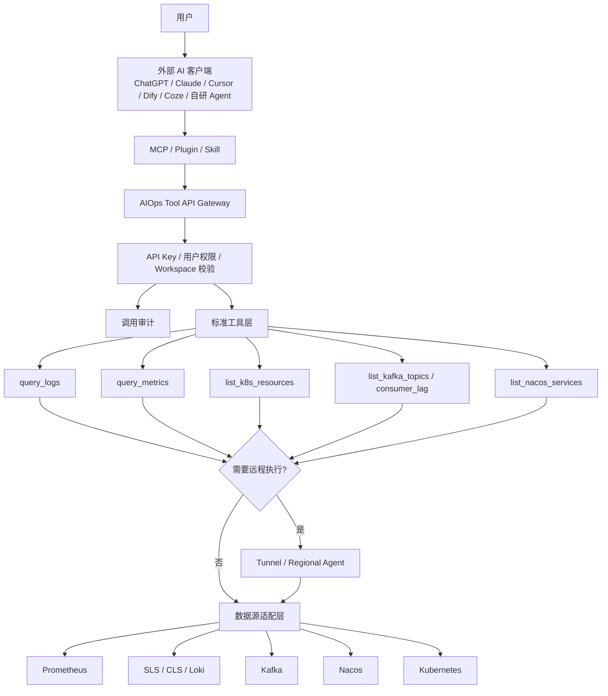

# AIOps Tool Server 设计思路

## 1. 一句话定位

AIOps Platform 不应主打“智能运维聊天页面”，而应定位为：

> 企业运维数据源的统一接入层、标准查询层和 AI Tool Server。平台负责管理和安全，Plugin/MCP 负责让外部 AI 使用这些运维能力。

对于全球业务，还需要补充一个关键能力：

> AIOps Platform 必须具备跨地域网络执行层。本地无法直连的 US/EU/CN 私有数据源，应通过对应地域的 SSH 隧道节点或 Agent 节点执行查询。

## 2. 背景问题

企业运维系统通常分散在多种工具中：

- Prometheus：指标、告警、PromQL
- SLS / CLS / Loki / Elasticsearch：日志
- Kubernetes：Pod、Deployment、Service、Event、资源状态
- Kafka：Topic、Consumer Group、Offset、Lag
- Nacos / Consul：服务注册、实例状态
- MySQL / Redis / HTTP / TCP：业务或基础连通性数据
- SSH Tunnel / Regional Agent：跨地域访问入口

AI 工具本身不天然知道：

- 哪些数据源存在
- 每个数据源属于哪个地域、环境、业务域
- 如何鉴权
- 哪些数据源能查日志、指标、Kafka、Nacos 或 K8s
- 哪些数据可以跨环境查询，哪些不能
- 查询结果如何限制大小、脱敏和审计

所以系统难点不是“做一个 AI 问答窗口”，而是让 AI 能安全、规范、准确地使用企业运维能力。

## 3. 产品边界

### 3.1 平台负责

- 数据源接入和配置
- 数据源密钥托管
- 工作空间隔离
- 用户、角色、权限和 API Key
- 标准 Tool API
- 工具调用审计
- 数据源适配器
- SSH 隧道和地域执行节点
- 查询范围、超时、限流、脱敏

### 3.2 Plugin / MCP / Skill 负责

- 暴露工具定义给 AI 客户端
- 告诉 AI 什么时候使用哪个工具
- 把自然语言转成 Tool API 调用
- 把工具结果整理成用户可理解的结论
- 在问题不明确时引导 AI 追问

### 3.3 不做什么

- 不把重点放在平台内聊天框
- 不让 AI 直接连接底层数据源
- 不把数据源密钥暴露给 AI 客户端
- 不抓取 Kafdrop、Nacos 控制台等 UI 页面作为主要能力
- 不允许未授权跨工作空间查询

## 4. 总体架构



## 5. 核心抽象

### 5.1 Workspace

Workspace 是 AI 查询范围的硬边界。

示例：

- CN 测试
- CN 生产
- EU 生产
- IoT 业务域
- 消息推送业务域

规则：

- 用户指定 Workspace 后，AI 默认只能查该 Workspace 关联的数据源。
- Workspace 存在但未关联数据源时，不回退全局。
- 跨 Workspace 查询必须用户明确表达，且 API Key 有权限。

### 5.2 Datasource

每个数据源除了连接信息，还需要运维语义元信息：

| 字段 | 示例 | 作用 |
| --- | --- | --- |
| `type` | `prometheus`, `sls`, `kafka`, `k8s` | 数据源类型 |
| `region` | `cn`, `eu`, `us` | 地域筛选 |
| `env` | `prod`, `test`, `staging` | 环境筛选 |
| `domain` | `iot`, `message`, `user` | 业务域筛选 |
| `capabilities` | `logs`, `metrics`, `kafka`, `k8s`, `registry` | 能力标签 |
| `priority` | `100` | 多候选排序 |

示例：

```text
腾讯生产CLS
region=cn
env=prod
domain=common
capabilities=logs

test kafka
region=cn
env=test
domain=iot
capabilities=kafka
```

### 5.3 Tool

Tool 是 AI 可以调用的平台能力。

工具设计原则：

- AI 只传 `workspace`、`datasource_id`、业务参数。
- AI 不传真实 URL、Token、AK/SK、kubeconfig。
- 后端根据权限和 Workspace 选择数据源。
- 后端负责超时、限流、结果大小控制和审计。

### 5.4 Tunnel / Remote Executor

Tunnel 是跨地域数据源访问的网络执行入口。

典型场景：

```text
AIOps 平台部署在 CN。
US Prometheus / Kafka / Nacos 在 US 内网，本地无法直连。
购买一台 US 跳板机，或在 US 环境部署一个轻量 Agent。
平台查询 US 数据源时，通过 US 隧道节点执行。
```

Tunnel 类型：

| 类型 | 说明 | 适合场景 |
| --- | --- | --- |
| `ssh` | 通过 SSH 跳板机建立端口转发或执行远程代理命令 | 快速落地、无需额外常驻服务 |
| `agent` | 在目标地域部署 AIOps Agent，平台通过 HTTPS/gRPC 调用 | 长期生产化、多协议、多租户 |

Tunnel 元信息：

| 字段 | 示例 | 作用 |
| --- | --- | --- |
| `name` | `us-east-jumpbox` | 隧道名称 |
| `type` | `ssh`, `agent` | 隧道类型 |
| `region` | `us`, `eu`, `cn` | 地域 |
| `host` | `1.2.3.4` | 跳板机或 Agent 地址 |
| `auth_type` | `password`, `key`, `token` | 隧道鉴权方式 |
| `status` | `enabled` | 是否可用 |

Datasource 通过 `tunnel_id` 绑定远程执行入口。

规则：

- `tunnel_id = 0`：平台本地直连数据源。
- `tunnel_id > 0`：平台通过指定 Tunnel 查询数据源。
- 数据源 `region` 应和 Tunnel `region` 一致，不一致时需要提示或阻止。
- AI 工具不感知 Tunnel。AI 只选择 Workspace 和 Tool，平台内部决定直连还是走 Tunnel。
- 隧道密钥只保存在平台，不能返回给 Plugin/MCP/AI 客户端。

SSH Tunnel 的执行模式建议：

```text
1. HTTP 类数据源
   平台建立本地端口转发：
   localhost:random_port -> ssh_jumpbox -> target_host:target_port
   然后用原有 HTTP client 请求 localhost:random_port。

2. Kafka 类数据源
   优先通过远程 Agent 查询。
   如果先用 SSH 快速落地，需要处理 advertised.listeners：
   - broker metadata 返回的地址可能是内网地址
   - 平台本地无法访问这些地址
   - 需要 either 每个 broker 建立转发，or 在远程侧执行 Kafka 查询

3. Kubernetes 类数据源
   可通过 SSH 端口转发访问 API Server。
   kubeconfig 中 server 地址需要被临时改写为本地转发地址。

4. Nacos 类数据源
   和 HTTP 类数据源一致，端口转发后调用 Nacos Open API。
```

生产化建议：

```text
SSH tunnel 适合快速验证和少量数据源。
Regional Agent 更适合 Kafka、多 broker、并发查询和长期运行。
```

## 6. 标准工具清单

### 6.1 基础工具

| Tool | 作用 |
| --- | --- |
| `list_workspaces` | 查询 API Key 可访问的工作空间 |
| `list_datasources` | 查询工作空间内可用数据源 |
| `test_datasource_connection` | 测试数据源连接 |
| `list_tunnels` | 查询可用隧道节点 |
| `test_tunnel_connection` | 测试隧道节点连通性 |

### 6.2 查询工具

| Tool | 能力 | 底层数据源 |
| --- | --- | --- |
| `query_logs` | 查询日志 | SLS / CLS / Loki / Elasticsearch |
| `query_metrics` | 查询指标 | Prometheus |
| `list_k8s_resources` | 查询 K8s 资源 | Kubernetes |
| `list_kafka_topics` | 查询 Kafka topic | Kafka |
| `get_kafka_consumer_lag` | 查询消费堆积 | Kafka |
| `list_nacos_services` | 查询服务注册列表 | Nacos |
| `get_nacos_service_instances` | 查询服务实例 | Nacos |

### 6.3 编排工具

| Tool | 作用 |
| --- | --- |
| `analyze_error_logs` | 分析某时间段 error 日志 |
| `analyze_kafka_lag` | 分析 Kafka 消费堆积 |
| `analyze_service_health` | 分析某服务健康状态 |
| `analyze_incident` | 故障场景综合分析 |

编排工具可以调用多个底层工具，但仍由平台控制范围和权限。

## 7. 用户问题到工具调用流程

### 7.1 示例问题

用户问：

```text
帮我分析 11 点到 12 点为什么日志有 error，去 CN 测试环境里看。
```

### 7.2 系统解析

```json
{
  "intent": "analyze_error_logs",
  "time_range": {
    "from": "2026-08-01T11:00:00+08:00",
    "to": "2026-08-01T12:00:00+08:00"
  },
  "filters": {
    "region": "cn",
    "env": "test",
    "capabilities": "logs"
  }
}
```

### 7.3 数据源选择

选择逻辑：

```text
1. 取用户当前 workspace 或问题中指定 workspace
2. 加载 workspace 关联数据源
3. 过滤 status=enabled
4. 过滤 capabilities=logs
5. 过滤 region=cn
6. 过滤 env=test
7. 按 priority 排序
8. 判断访问路径：`tunnel_id=0` 本地直连，`tunnel_id>0` 通过对应 Tunnel/Agent 执行
9. 候选为 0 或多个不明确时追问
```

### 7.4 调用工具

```json
{
  "tool": "query_logs",
  "params": {
    "workspace": "CN 测试",
    "query": "error",
    "from": "2026-08-01T11:00:00+08:00",
    "to": "2026-08-01T12:00:00+08:00",
    "limit": 100
  }
}
```

### 7.5 扩展分析

如果日志结果中发现：

- service name
- pod name
- topic name
- error code

再按证据扩展：

```text
service/pod -> 查 K8s
topic -> 查 Kafka lag
service -> 查 Nacos 实例
错误率/延迟 -> 查 Prometheus
```

原则：先用日志定位，再按证据扩展，不一开始扫描所有数据源。

## 8. API Key 和权限设计

用户不登录平台，也可以通过外部 AI 使用能力，但必须使用 API Key。

API Key 绑定：

- 用户或服务账号
- 可访问 Workspace 列表
- 可调用 Tool 列表
- 只读 / 写权限
- 过期时间
- 速率限制

示例：

```json
{
  "name": "cursor-aiops-key",
  "subject": "jimmy",
  "workspaces": ["CN 测试"],
  "tools": [
    "list_datasources",
    "query_logs",
    "query_metrics",
    "list_kafka_topics",
    "get_kafka_consumer_lag"
  ],
  "readonly": true,
  "expires_at": "2026-12-31T23:59:59+08:00"
}
```

## 9. 安全设计

### 9.1 基本原则

- AI 不直接拿数据源密钥。
- AI 不直接访问底层数据源。
- AI 只能调用平台白名单工具。
- 平台执行前校验 API Key、Workspace、Tool 权限。
- 查询结果需要大小限制和必要脱敏。
- 远程数据源只能通过绑定的 Tunnel/Agent 查询，不能把底层内网地址暴露给 AI 客户端。

### 9.2 工具执行校验

每次工具调用都必须校验：

```text
1. API Key 是否有效
2. API Key 是否允许访问 workspace
3. API Key 是否允许调用 tool
4. datasource_id 是否属于 workspace
5. tool 是否支持该 datasource type
6. datasource 是否需要 tunnel，tunnel 是否启用且 region 匹配
7. time range 是否超过限制
8. limit 是否超过上限
```

### 9.3 写操作策略

第一阶段只开放只读工具。

后续如果需要写操作，例如：

- 重启服务
- 执行脚本
- 修改配置
- 扩缩容

必须增加：

- 二次确认
- 风险级别
- 审批策略
- 回滚建议
- 强审计

## 10. 审计设计

每次工具调用记录：

| 字段 | 说明 |
| --- | --- |
| `request_id` | 调用链路 ID |
| `api_key_id` | 调用方 |
| `client` | MCP / Plugin / 平台内置 |
| `workspace_id` | 工作空间 |
| `tool` | 工具名 |
| `datasource_id` | 数据源 |
| `tunnel_id` | 远程执行入口，0 表示本地直连 |
| `params_digest` | 参数摘要 |
| `time_range` | 查询时间范围 |
| `result_count` | 返回数量 |
| `duration_ms` | 耗时 |
| `status` | 成功 / 失败 |
| `error` | 错误信息 |

审计目标：

- 谁查了生产日志
- 哪个 AI 客户端调用了哪些工具
- 查询是否越权
- 哪些工具慢或失败频繁

## 11. MCP / Plugin / Skill 设计

### 11.1 MCP Server

优先做 MCP，因为通用性更好。

MCP Server 暴露：

- `list_workspaces`
- `list_datasources`
- `query_logs`
- `query_metrics`
- `list_kafka_topics`
- `get_kafka_consumer_lag`
- `list_nacos_services`
- `list_k8s_resources`

MCP Server 不直接连数据源，只调用 AIOps Tool API。

### 11.2 Plugin

Plugin 面向特定 AI 平台。

包括：

- manifest
- OpenAPI schema
- auth 配置
- 工具描述

### 11.3 Skill

Skill 是“如何使用工具”的经验文档。

应包含：

- 日志问题先查 logs
- Kafka 堆积先查 consumer lag
- 服务发现问题查 Nacos
- 容器状态问题查 K8s
- 指标问题查 Prometheus
- 范围不明确时先追问

## 12. 分阶段规划

### 阶段一：平台工具化基础

目标：平台具备 AI Tool Server 雏形。

任务：

- 数据源元信息：region/env/domain/capabilities/priority
- Workspace 硬边界
- Tool API 初版
- 只读工具白名单
- 后端工具执行范围校验
- 节点管理统一维护 SSH 与 Agent 节点

状态：

- 当前项目已开始落地数据源元信息和 Workspace 硬边界。
- 当前项目保留数据源 `tunnel_id` 兼容字段；新增远程执行能力统一通过 SSH/Agent 节点演进，不再提供独立隧道管理入口。
- Kafka、Nacos、K8s、SLS/CLS、Prometheus 已具备部分工具能力。

### 阶段二：跨地域执行层

目标：平台本地无法直连的数据源，可以通过对应地域的 SSH 隧道或 Agent 查询。

任务：

- SSH 节点
- 本地端口转发生命周期管理
- Prometheus / HTTP 类数据源走 tunnel 查询
- Kafka 通过 tunnel 查询 broker metadata 和 lag
- Nacos 通过 tunnel 查询服务注册
- 隧道健康检查和失败降级
- 数据源 region 与 tunnel region 一致性校验

建议路线：

```text
先做 SSH tunnel，快速支持 US/EU 跳板机。
再做 Regional Agent，解决长连接、并发、多协议和生产稳定性。
```

### 阶段三：API Key 和审计

目标：外部 AI 可以不登录平台，但受控调用工具。

任务：

- API Key 管理
- API Key 绑定 workspace/tool 权限
- Tool API Gateway
- 调用审计表
- 查询限流和超时

### 阶段四：MCP Server

目标：让 Claude、Cursor、自研 Agent 等 AI 客户端接入。

任务：

- MCP server skeleton
- 工具 schema
- API Key auth
- 调用 AIOps Tool API
- 本地安装说明

### 阶段五：编排型分析工具

目标：从“查数据”升级到“分析问题”。

任务：

- `analyze_error_logs`
- `analyze_kafka_lag`
- `analyze_service_health`
- `analyze_incident`
- 结果摘要和证据链

### 阶段六：生态交付

目标：让别人的 AI 工具能快速安装和使用。

任务：

- Plugin manifest
- OpenAPI 文档
- Skill 文档
- Dify / Coze 工具包
- 接入示例
- 最小 demo

## 13. 关键取舍

### 13.1 为什么不是只做平台聊天框

平台聊天框只能服务登录平台的用户，价值边界小。

Plugin/MCP 可以让能力进入用户已有 AI 工具，集成价值更大。

### 13.2 为什么不是只做 Plugin

Plugin 没法安全管理数据源、密钥、权限和审计。

必须有平台作为控制面。

### 13.3 为什么 Tool API 要独立设计

页面 API 面向前端 UI，通常参数细、结构杂。

Tool API 面向 AI，必须：

- 语义明确
- 参数稳定
- 返回可摘要
- 有权限边界
- 有审计

## 14. 成功标准

第一阶段成功标准：

- 用户可以在平台配置数据源和 workspace。
- AI 查询时只看到当前 workspace 的数据源。
- 工具调用不能跨 workspace。
- Kafka/Nacos/K8s/日志/指标至少有一批只读工具可用。

第二阶段成功标准：

- 外部 AI 客户端通过 API Key 调用工具。
- 调用记录可审计。
- API Key 可以限制 workspace 和 tool。

第三阶段成功标准：

- 一个外部 AI 客户端通过 MCP 安装后，可以问：

```text
CN 测试环境 11 点到 12 点有哪些 error？
test kafka 哪些 consumer group 有堆积？
test nacos 注册了哪些服务？
test k8s 有哪些异常 pod？
```

并且无需登录平台页面。

## 15. 推荐对外表述

短版本：

> 我们不是做一个智能运维聊天页面，而是做企业运维能力的 AI Tool Server。平台负责数据源、权限、工作空间和审计；Plugin/MCP 负责让任何 AI 工具安全使用这些运维能力。

长版本：

> AIOps Platform 将 Prometheus、SLS、CLS、Kafka、Nacos、Kubernetes 等企业运维数据源统一接入，并抽象成标准 Tool API。外部 AI 工具通过 Plugin/MCP 安装后，可以在不登录平台页面的情况下，基于 API Key 和工作空间权限安全调用这些工具完成日志、指标、服务注册、Kafka 堆积和 K8s 状态分析。
