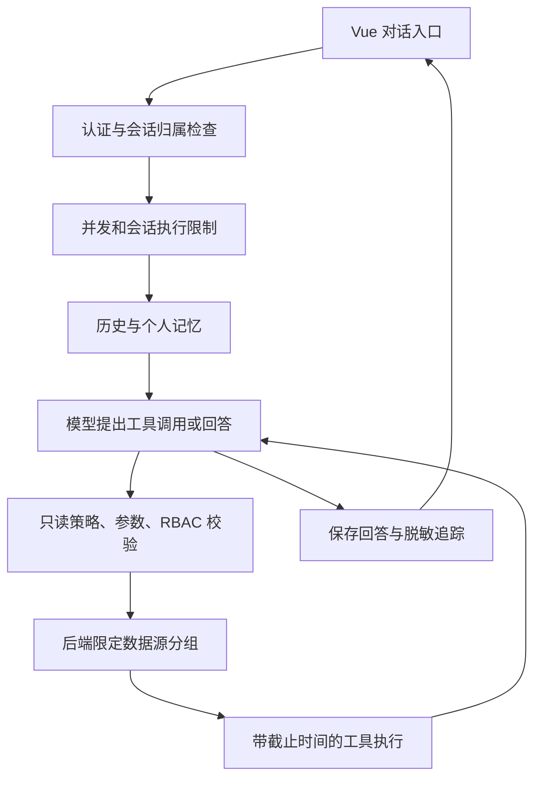

# 观澜 AI 助手实施方案

更新日期：2026-10-20。目标：用户用自然语言调用观澜已有运维能力，回答有证据、执行可追溯、权限由后端决定。部署继续采用 Vue + Go + SQLite 单二进制。

## 现状盘点

本方案依据 internal/ai、internal/handlers/chat.go、llm.go、internal/models/chat.go 和两个前端聊天入口的代码，而非参考图中的“增强前”假设。

| 能力 | 当前基础 | 需要补齐 |
| --- | --- | --- |
| 会话 | SQLite 保存会话和消息，查询按用户隔离，最近 10 条历史和个人记忆进入提示 | 排除重复的当前问题、上下文预算、资源焦点和摘要 |
| 模型编排 | 自定义 JSON tool_call/final，最多 8 轮，Anthropic 协议客户端 | 失败追踪保留、统一截止时间、结构化错误、后续评估原生工具调用 |
| 工具 | Prometheus、K8s、SLS、CLS、Nacos、Kafka 共 8 个只读工具 | 参数结构检查、权限检查、落实超时；不直接开放任意 HTTP/SQL/命令 |
| 资源范围 | workspace_id 实际表示数据源分组；调用前由后端覆盖范围参数 | 它不是租户或用户授权边界；独立资源授权模型仍待设计 |
| 追踪 | 消息 metadata 保存部分成功调用信息 | 每次运行标识、状态、耗时、失败步骤和前端详情 |
| 写操作 | 旧关键词分支存在“确认创建数据源”逻辑 | 需要正式的审批记录、操作摘要、权限复核、过期与幂等；不能充当模型失败回退 |
| 重试 | 模型客户端最多 3 次，退避使用 Sleep | 可取消退避；工具重试仅在明确幂等且瞬时失败时启用 |
| 前端 | 右上角 AIChatAssistant.vue 聊天面板 | 共享追踪展示组件，后续加入流式事件、停止执行与恢复 |

## 架构与边界

- `internal/ai`：协议、注册表、执行循环、运行/步骤追踪；不依赖 Gin、数据库或具体供应商。
- `internal/handlers`：第一批复用现有业务适配器；后续抽到 `internal/ai/tools` 和业务 service，避免一次性重写所有接入。
- `internal/models`：已有 ChatMessage.Metadata 承载第一批追踪，不新增表，不修改现有数据库版本。
- `web/src/components/AIExecutionTrace.vue`：聊天面板中的执行详情展示。
- `pkg` 只承接可独立复用的基础设施，不把业务权限、会话和工具编排搬进去。
- 不强制引入 eino、Redis 或向量数据库。现有 HTTP API 继续使用；MCP 是可选工具接入协议，不是每个本地调用的必经层。

## 分阶段交付

### P0-A：可观测且受控的只读调用（本批）

- 每次编排生成 run_id；保存运行状态、总耗时、各轮模型/工具步骤、错误码、工具耗时。失败也保留已完成步骤。
- 追踪不保存模型原文、工具参数、凭据、工具返回正文或原始供应商错误；结果仍回传模型供分析。
- 强制只读风险级别；未知工具、非法参数、拒绝授权均不执行。每次工具执行前复核用户与现有 `datasource:list` 权限。
- 数据源目录只提供给拥有上述权限的用户；后端继续限定会话的数据源分组。该权限目前是粗粒度能力，不宣称实现行级/租户授权。
- 默认最多 8 轮、运行预算 120 秒、全局最多 4 个聊天请求、同一会话最多 1 个请求；满额明确拒绝，不无限排队。
- 工具使用声明的 10/15 秒子上下文；Prometheus、K8s 接入支持请求取消；其他旧 SDK/连接器暂有协作取消限制，超时后不得开始下一轮。
- 模型退避响应取消；对超大结果使用有效 JSON 摘要，避免截断 UTF-8/JSON。
- 去掉模型失败后自动执行旧关键词分支：失败返回可解释状态，不隐式启动另一套查询或写操作。
- 右上角聊天面板显示执行详情，持久化后重新打开会话可查。

验收：模拟模型和工具覆盖成功、拒绝、未知工具、参数错误、失败后保留步骤、截止时间、轮次上限、大结果；验证禁用用户/无权限不能调用；前端构建、Go 测试和二进制构建通过。

### P0-B：上下文与完整运行生命周期

- 会话焦点（数据源/namespace/时间范围）、上下文摘要与长度预算；切换资源需要消歧。
- 所有连接器端到端支持取消；增加运行表、取消 API、流式步骤事件和前端停止按钮。
- 运行表需要正式 SQLite 版本迁移，不能通过启动时无差别 AutoMigrate 处理旧库；重启将未结束运行标记为中断。
- 独立资源授权模型；审批和资源权限变更后重新鉴权；并发预算改为配置项。

### P1：多步骤排障

- 计划步骤有 ID、依赖、输入输出和状态；只并行无依赖步骤，限制总调用数和并发。
- 只读且声明幂等的工具才允许自动重试，统一退避预算；不能因模型不断修改参数无限重试。
- 缓存先按工具选择加入，键包含权限范围、数据源、规范化参数与查询时间；缓存命中仍鉴权、追踪并进入汇总，不直接绕过模型回答。
- 知识检索先用已有平台说明/用户知识，给出来源与更新时间；检索文本视为数据，不能覆盖执行策略。

### P2：受控处置与运营

- 审批记录绑定用户、资源、规范化参数、内容摘要与过期时间；批准后重查权限、校验幂等键。
- 批量执行需要预览目标、限制数量、记录逐项结果和失败策略。
- 主动推荐先做可解释规则建议，不自动变更资源。
- 反馈保存到运行，建立固定问题评测集，人工审核后改进提示/知识/工具；收集点赞不等于自动训练。

## 本批交付记录

P0-A 已完成，P0-B / P1 / P2 尚未实施。阶段顺序基于依赖关系，不承诺参考图中未经评估的固定月份工期。

验证记录：

- `go test ./...`：通过；覆盖编排状态、权限拒绝、并发限制、历史隔离、退避取消及现有业务回归。
- `go test ./internal/ai`：新增工具声明截止时间测试通过。
- `NODE_OPTIONS=--max-old-space-size=4096 npm run build`（web 目录）：通过；保留现有大分块构建警告。
- `CGO_ENABLED=0 go build -trimpath -o guanlan ./cmd/guanlan`：通过，前端已嵌入。
- `python3 test/smoke/ai_execution.py`：本地模拟模型验证管理员登录、调用失败步骤、模型汇总、追踪入库及重新读取；模型 HTTP 400 时保存失败追踪，不进入旧写操作确认分支，不暴露模型服务原始错误。脚本使用临时数据库和动态本地端口。

验收限制：测试使用模拟模型和不存在的数据源验证调用链，没有连接真实生产模型或外部监控资源；前端完成构建校验，尚未做浏览器交互验收。追踪在请求结束后展示，尚非实时流式事件。旧 SLS/CLS/Nacos/Kafka 适配器可能在上下文截止后仍等待其自身超时，不能宣称所有查询都能立即停止。没有新增资源级授权或审批功能。
