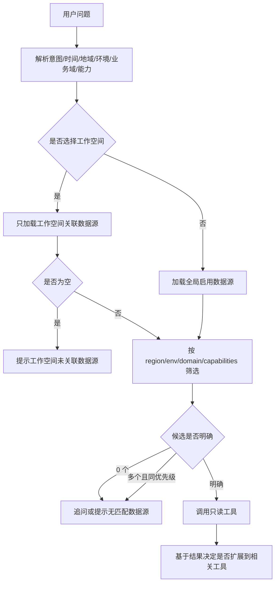

# Workspace Scoped Analysis

## 背景

接入中心会持续增加 Prometheus、SLS、CLS、Kubernetes、Nacos、Kafka 等数据源。智能客服如果只拿到全量数据源列表，用户说“帮我分析 11 点到 12 点为什么有 error”时，模型容易选到无关地域、环境或业务域的数据源，导致误查、慢查和错误结论。

目标是把智能客服查询从“全局猜测”改为“工作空间硬边界 + 数据源元信息筛选 + 证据驱动扩展”。

## 目标

- 用户在某个工作空间内提问时，默认只查询该工作空间关联的数据源。
- 用户提到地域、环境、业务域、能力类型时，优先筛选匹配的数据源。
- 当问题是日志类问题时，先查询日志数据源，再根据日志证据扩展到 K8s、Kafka、Nacos 或 Prometheus。
- 当数据源范围不明确且候选过多时，智能客服应追问，而不是全局扫描。

## 非目标

- 第一阶段不做复杂 CMDB 拓扑推理。
- 第一阶段不自动跨工作空间查询。
- 第一阶段不从 Kafdrop、Nacos 控制台等 UI 抓取数据，统一走后端只读工具。

## 数据模型

Datasource 增加运行域元信息：

| 字段 | 示例 | 用途 |
| --- | --- | --- |
| `region` | `cn`, `eu`, `us` | 地域筛选 |
| `env` | `prod`, `test`, `staging` | 环境筛选 |
| `domain` | `iot`, `message`, `user` | 业务域筛选 |
| `capabilities` | `logs,metrics,kafka` | 能力筛选 |
| `priority` | `100` | 多候选排序 |

Workspace 继续作为数据源集合的硬边界。工作空间为空时允许全局查询；工作空间存在但未关联数据源时，不回退全局，直接提示先关联数据源。

## 查询选择流程

## 意图到能力映射

| 用户意图 | 优先能力 | 工具示例 |
| --- | --- | --- |
| error 日志、异常堆栈、请求失败 | `logs` | SLS / CLS / Loki 查询 |
| CPU、内存、QPS、错误率 | `metrics` | Prometheus |
| Pod、Deployment、Namespace 状态 | `k8s` | Kubernetes API |
| 服务注册、实例数 | `registry` | Nacos |
| topic、消费堆积、consumer group | `kafka` | Kafka metadata / lag |

## 工具调用约束

- 工具只接收 `datasource_id` 和业务参数，不允许 LLM 直接传 URL、token 或鉴权信息。
- 后端在工具执行前再次校验数据源是否属于当前工作空间。
- 只读工具无需用户确认；写操作仍需显式确认。
- 结果进入 LLM 前要限制大小，例如 Kafka lag 明细默认最多 200 行。

## 第一阶段落地

1. Datasource 增加 `region/env/domain/capabilities/priority` 字段。
2. 接入中心保存和返回这些字段。
3. 工作空间有 ID 时，智能客服数据源目录严格限制为关联数据源；如果未关联，不再回退全局。
4. 智能客服数据源目录中注入元信息，帮助模型选择正确数据源。
5. 后端工具加载数据源时支持工作空间校验，避免模型传入非当前工作空间的数据源 ID。

## 第二阶段落地

1. 前端工作空间关联数据源弹窗支持按地域、环境、业务域、能力筛选。
2. 智能客服增加结构化查询计划 metadata，用于展示“本次为什么查这些数据源”。
3. 日志分析路径增强：日志命中 service/topic/pod 后，再扩展调用 Kafka/K8s/Nacos。

## 风险

- 历史数据源缺少元信息，第一阶段需要允许空值，但空值只能作为低优先级候选。
- `capabilities` 如果完全靠人工填容易不一致，需要后端按类型给默认能力。
- 工作空间未关联数据源时用户会觉得“之前能查现在不能查”，需要明确提示去关联。
